<!-- COLDBIT · est. 2018 — icy pixel-art profile. Static art: scripts/build_assets.py · live cards: .github/workflows/profile.yml -->

  &nbsp;
  &nbsp;
  

  <a href="https://coldbit.cz"></a>

  

  

  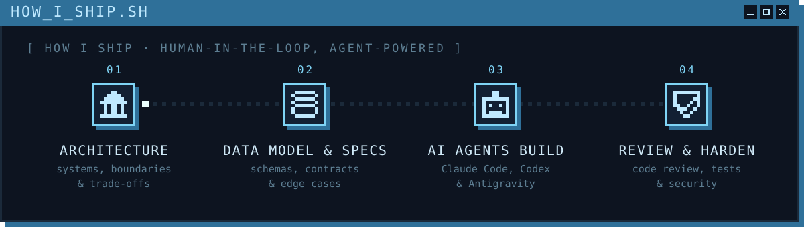

  <a href="https://ailin.cz">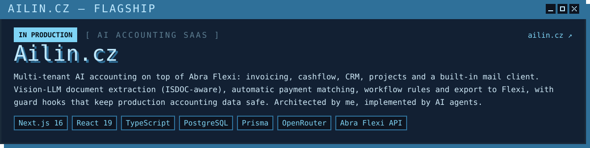</a>

  <a href="https://coldbit.cz">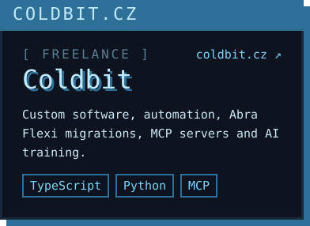</a>
  <a href="https://github.com/DrGumik/rtk">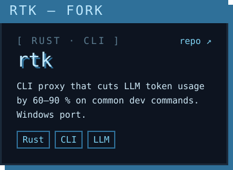</a>
  <a href="https://github.com/DrGumik/tex-compiler">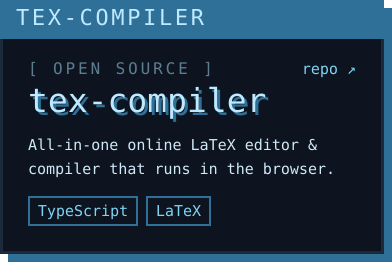</a>

  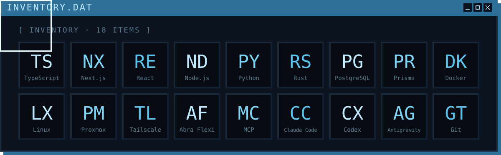

<!-- live cards, regenerated daily by .github/workflows/profile.yml into the "output" branch -->

  
  

  

  

  
   
  

